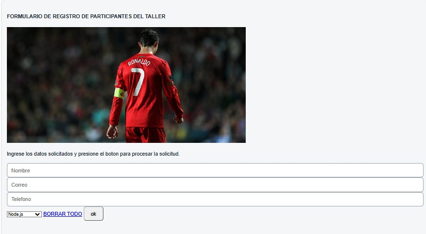
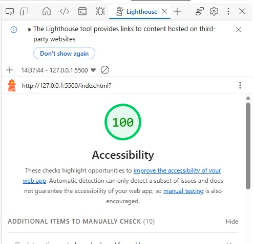

# Auditoría UX/UI - App Notas

Este documento detalla la evaluación de la interfaz original de la aplicación de notas utilizando las 5 heurísticas de usabilidad de Nielsen y las leyes de diseño (Fitts, Hick y Miller).

## 1. Tabla de Auditoría Heurística (5 Heurísticas de Nielsen)

| Heurística | Problema Original | Solución Aplicada |
| :--- | :--- | :--- |
| **Visibilidad del estado** | Al agregar o eliminar una nota, la interfaz no mostraba ningún mensaje de confirmación al usuario. | Se añadió un contenedor de mensajes dinámicos (`role="status"`) que avisa claramente cuando se crea o elimina una nota con éxito. |
| **Coincidencia con el mundo real** | Los textos y botones usaban terminología técnica del sistema en lugar del lenguaje natural y cotidiano del usuario. | Se cambiaron los textos de los controles por términos claros y familiares («Crear nota», «Guardar», «Eliminar»). |
| **Control y libertad** | El botón de eliminar borraba notas inmediatamente sin dar opción de marcha atrás ni pedir confirmación. | Se implementó una ventana de confirmación (`confirm()`) antes de ejecutar acciones destructivas sobre las notas. |
| **Prevención de errores** | Permitía registrar notas totalmente vacías o sin contenido relevante sin mostrar una advertencia previa. | Se aplicó validación en JavaScript y el atributo `required` para bloquear el envío de notas vacías y señalar el error. |
| **Reconocer, no recordar** | Los campos del formulario usaban únicamente `placeholder` que desaparecían al empezar a escribir. | Se reemplazaron por etiquetas permanentes (`<label>`) asociadas directamente a cada campo de entrada. |

## 2. Aplicación de Leyes de Usabilidad

* **Ley de Fitts:** El botón principal para registrar notas se rediseñó con un tamaño táctil adecuado (`min-height: 44px`), maximizando su área de clic y separándolo de las acciones secundarias para evitar errores accidentales.
* **Ley de Hick:** Se simplificó la interfaz principal agrupando los elementos para reducir el tiempo de decisión del usuario y evitar la sobrecarga visual de opciones innecesarias.
* **Ley de Miller:** Se estructuró la información en bloques visuales independientes y manejables para mantener la carga cognitiva dentro del límite de la memoria de trabajo humana (7±2 elementos).

## 3. Capturas del Antes y el Después

### Antes (Interfaz Original)

### Después (Interfaz Rediseñada)

### Puntaje de Lighthouse (Accesibilidad)
